<p align="center">
  <picture>
    <source media="(prefers-reduced-motion: reduce)" srcset="assets/readme/art/static/hero.webp">
    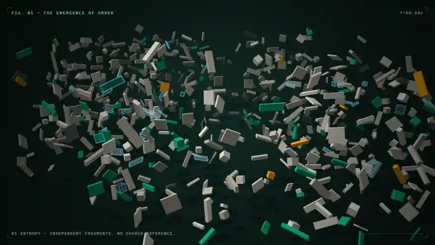
  </picture>
</p>

<p align="center">
  <a href="LICENSE"></a>
  <a href=".github/workflows/ci.yml"></a>
  <a href="package.json"></a>
  <a href="#14--deployment-and-availability"></a>
</p>

<h1 align="center">FORMSPEAR</h1>
<p align="center"><b>ORDER FROM COMPLEXITY</b><br><sub>Forms, surveys and feedback operations on a single zero-framework Node.js process.</sub></p>

<p align="center">
  <a href="#03--start-building"><b>Start building</b></a> ·
  <a href="docs/ARCHITECTURE.md">Architecture</a> ·
  <a href="docs/API.md">API</a> ·
  <a href="docs/DEPLOYMENT.md">Deployment</a> ·
  <a href="docs/readme-art/ANIMATION_INVENTORY.md">About the artwork</a>
</p>

---

## 01 — Order from Complexity

Feedback arrives as fragments: a rating here, a sentence there, a file, a date, a phone number from one branch of one clinic. On their own they are noise. **Formspear is an instrument for turning that noise into structure** — you design the form, the rules that shape it, and the records it produces, and the system keeps the structure intact from the first answer to the last report.

The animations in this README are the argument in motion. Each is a deterministic render built from the product's own vocabulary: real question types, real rule actions, real directories, real screenshots, real repository statistics. Where a scene is illustrative it says so on the frame.

<br>

## 02 — Meet Formspear

Formspear (internally **FeedbackOS**) is a full-stack forms, surveys, feedback, analytics, AI-insight, billing and operations platform. It is written for service networks — clinics, academies, retail and consultancies — that need to capture feedback in many places, attribute it to a branch, escalate the bad moments quickly, and report on the rest.

- **Capture** through a lean public respondent runtime (`/s/:slug`), a website embed (`public/embed.js`) and an in-app SDK (`public/sdk.js`).
- **Structure** answers against a survey schema with 23 question types, multi-page forms and rule-based logic.
- **Act** with alerts (WhatsApp, Slack, Microsoft Teams, email), HMAC-signed outbound webhooks and AI summaries.
- **Operate** with workspaces, team roles, API keys, branded surveys, billing (Stripe, Razorpay) and an admin readiness report.

The respondent bundle (`survey.html` + `survey.js` + `styles.css`) is **9,803 bytes gzipped**, enforced by `npm run performance:budget` against a 20,480-byte budget.

<br>

## 03 — Start Building

```bash
git clone https://github.com/DecoyINDIA/Formspear.git
cd Formspear
npm install
npm start
```

Open <http://localhost:4173>. The first account you create becomes the platform super-admin for that install. Copy `.env.example` to `.env` to configure keys; production start-up is fail-closed and requires PostgreSQL (see [deployment](#14--deployment-and-availability)).

<table align="center">
  <tr>
    <td width="50%" valign="top">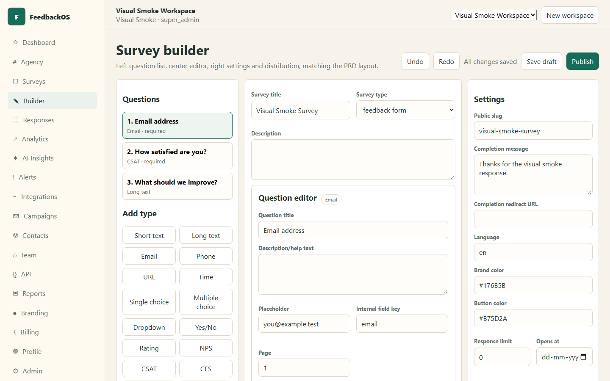<br><sub><b>Survey builder</b> — real capture from the visual smoke pipeline.</sub></td>
    <td width="50%" valign="top"><br><sub><b>Operator dashboard</b> — empty-state capture, no seeded demo data.</sub></td>
  </tr>
</table>

<br>

## 04 — The Form Architect

A form is a structure before it is a screen. Each question type is built here as its own specimen, snapped into a vertical structure, and then the concept resolves into the real survey builder.

<p align="center">
  <picture>
    <source media="(prefers-reduced-motion: reduce)" srcset="assets/readme/art/static/form-architect.webp">
    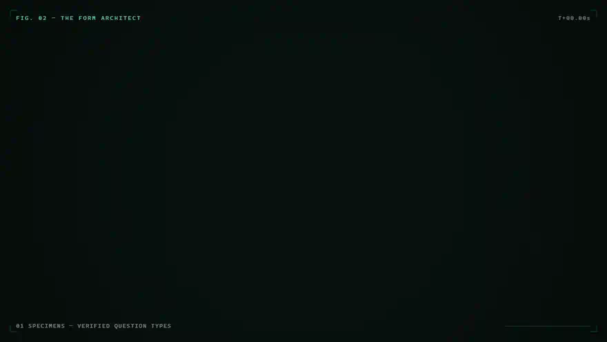
  </picture>
</p>

<br>

## 05 — Components of Possibility

The builder supports **23 question types**: `short_text`, `long_text`, `email`, `phone`, `url`, `number`, `single_choice`, `multiple_choice`, `dropdown`, `yes_no`, `rating`, `nps`, `csat`, `ces`, `star_rating`, `emoji_rating`, `date`, `time`, `consent`, `hidden`, `section`, `statement` and `file_upload` (the list lives in `QUESTION_TYPES`, `src/server.js`). One pool of 36 blocks rebuilds itself into seven of them, in turn:

<p align="center">
  <picture>
    <source media="(prefers-reduced-motion: reduce)" srcset="assets/readme/art/static/components.webp">
    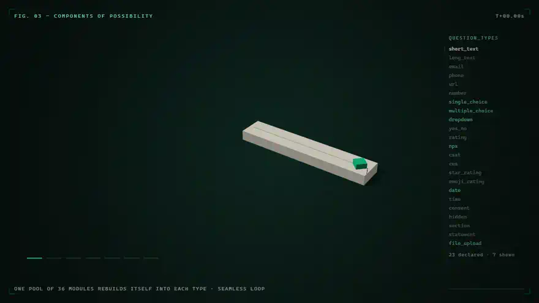
  </picture>
</p>

<br>

## 06 — The Logic Machine

Surveys adapt. Rules read an answer and act on the structure: `show_question`, `skip_to_question`, `assign_tag`, `trigger_alert`, `set_hidden_field`, `calculate_score`, `end_survey` and `redirect` are the engine's actions. Publishing validates the graph — skip logic must point to a **later** question, and circular paths are refused.

<p align="center">
  <picture>
    <source media="(prefers-reduced-motion: reduce)" srcset="assets/readme/art/static/logic-machine.webp">
    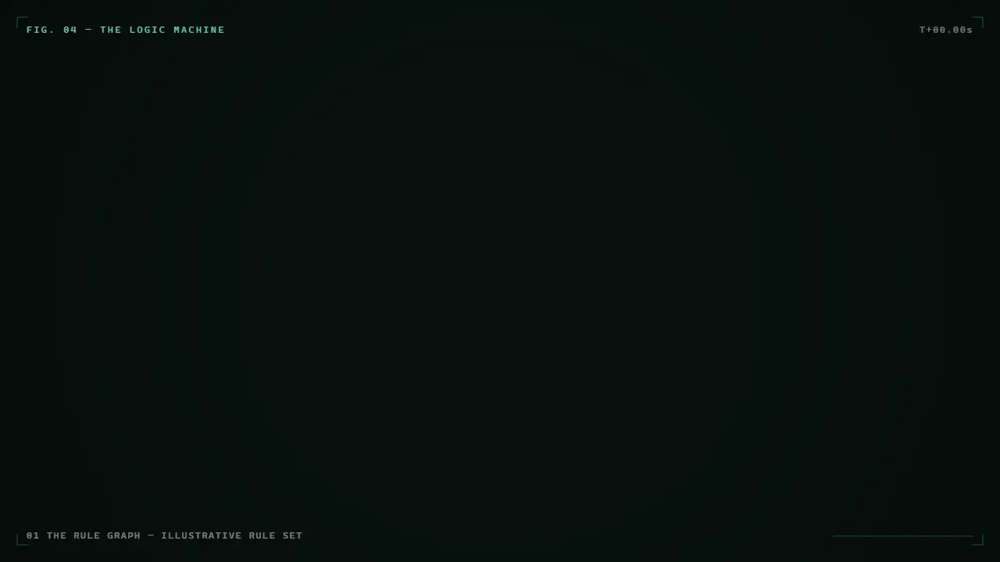
  </picture>
</p>

<sub>The score thresholds shown are an illustrative rule set; the action names and the refusal message are the engine's own.</sub>

<br>

## 07 — Information Becomes Structure

Start from the real public survey. Its three answers peel away as fragments, are typed, pass the server-side `validateAnswers` gate on submit, and settle as response records. The stream volume is illustrative; the stages are the product's.

<p align="center">
  <picture>
    <source media="(prefers-reduced-motion: reduce)" srcset="assets/readme/art/static/information-structure.webp">
    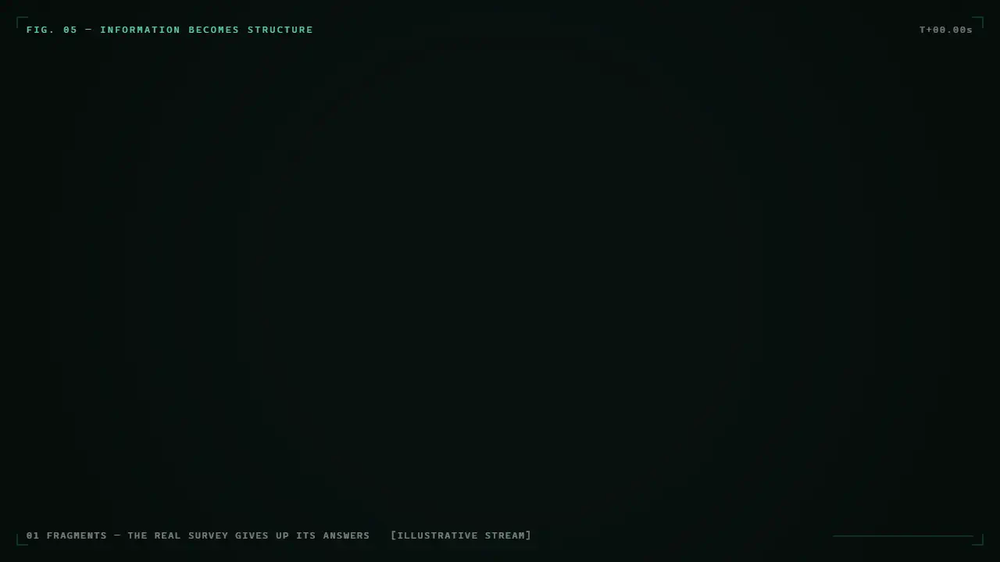
  </picture>
</p>

<br>

## 08 — Precision by Design

Four checks the engine really performs: required answers are validated on submit; choice questions need at least two options; skip logic must point to a later question; circular logic paths are blocked. The deviation readout is illustrative geometry, not a measurement.

<p align="center">
  <picture>
    <source media="(prefers-reduced-motion: reduce)" srcset="assets/readme/art/static/precision.webp">
    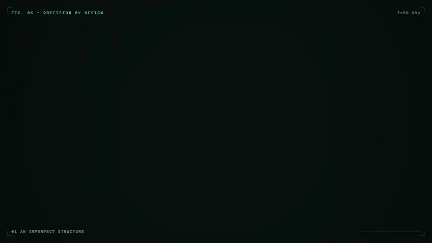
  </picture>
</p>

<br>

## 09 — The Workflow Continuum

The dashboard's own *first insight path* is four steps: **create from template → publish → collect a response → review the insight.** Here one survey object travels a single rail and changes state at each step; the response values are illustrative.

<p align="center">
  <picture>
    <source media="(prefers-reduced-motion: reduce)" srcset="assets/readme/art/static/workflow-continuum.webp">
    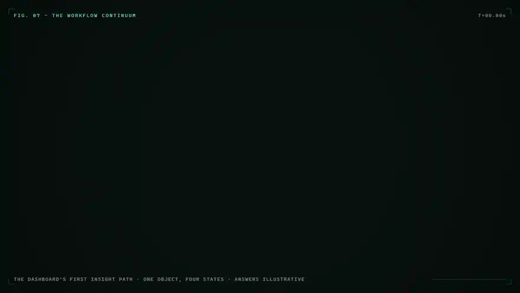
  </picture>
</p>

<br>

## 10 — Engineering Beneath the Surface

One Node.js process, no web framework. The system is layered from the browser edge down to external providers; every box below corresponds to a file or boundary in this repository.

<p align="center">
  <picture>
    <source media="(prefers-reduced-motion: reduce)" srcset="assets/readme/art/static/engineering.webp">
    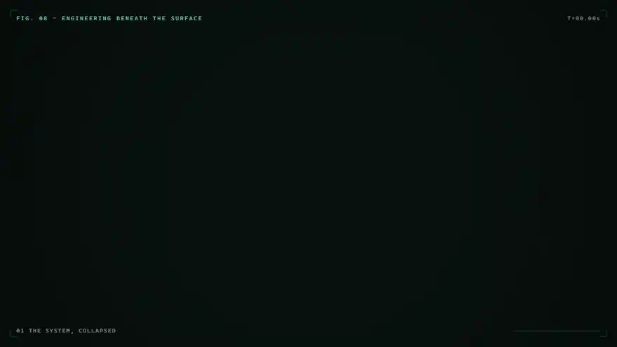
  </picture>
</p>

```text
public/  (survey.html · survey.js · app.js · embed.js · sdk.js)
   │
src/server.js  — node:http composition root · src/security.js · src/production-config.js
   │
src/routes/    — analytics · ai-summary · responses · billing · survey-lifecycle · auth-credentials · admin-readiness
src/lib/       — client-ip · features · http-body · outbound · static-assets
   │
persistence    — JSON store (development) · PostgreSQL (production, migrations/0001, 0002)
jobs           — in-process queue · optional Redis / BullMQ
   │
providers      — SMTP · WhatsApp · Slack · Teams · Stripe · Razorpay · OpenAI · S3-compatible storage
```

> [!IMPORTANT]
> Formspear runs as a **single writer**: one web process owns PostgreSQL and the job consumer (`numReplicas: 1` in `railway.json`). Redis is optional and only changes the queue transport. See [`docs/ARCHITECTURE.md`](docs/ARCHITECTURE.md).

<br>

## 11 — Connected by Design

Only integrations that exist in `src/server.js`: signed webhooks (event `response.completed`, HMAC-SHA256), Slack, Microsoft Teams, WhatsApp alerts, SMTP email, Stripe, Razorpay, OpenAI-backed summaries and S3-compatible file storage.

<p align="center">
  <picture>
    <source media="(prefers-reduced-motion: reduce)" srcset="assets/readme/art/static/integrations.webp">
    
  </picture>
</p>

<br>

## 12 — Open by Design

Formspear is released under the **MIT License**. The license text grants the right to *use, copy, modify, merge, publish, distribute, sublicense, and/or sell copies*. The scene opens a closed shell onto the real top-level directories — `public/`, `src/`, `migrations/`, `scripts/`, `tests/`, `docs/` — and docks a module of your own.

<p align="center">
  <picture>
    <source media="(prefers-reduced-motion: reduce)" srcset="assets/readme/art/static/open-by-design.webp">
    
  </picture>
</p>

<br>

## 13 — The Living Lattice

This sculpture is **regenerated from official GitHub data every six hours** by [`readme-lattice.yml`](.github/workflows/readme-lattice.yml). One cube is one commit, one tower is one week, an empty socket is a real zero. Nothing is invented, smoothed or back-filled; the history is append-only in [`assets/readme/metrics/snapshots.jsonl`](assets/readme/metrics/snapshots.jsonl).

<p align="center">
  
</p>

<!-- LATTICE:START -->
| Metric | Value | What it measures |
| :-- | --: | :-- |
| Stars | **0** | Repository stars (not users) |
| Forks | **0** | Forks of the repository |
| Contributors | **2** | GitHub accounts with commits |
| Releases | **0** | Published GitHub releases (0 release-asset downloads, 0 tags) |
| Commits | **49** | Commits on `main` |
| Weeks drawn | **23** | One tower per ISO week since the first commit in the window |
| Snapshot | 2026-11-28 | Official GitHub API; history in `assets/readme/metrics/snapshots.jsonl` |
<!-- LATTICE:END -->

<sub>Stars are repository stars, not users. Release downloads are release-asset downloads, not installations. The repository has no published releases yet, so no download figure is drawn.</sub>

<br>

## 14 — Deployment and Availability

Documented paths only. There is **no Dockerfile** in this repository, so none is claimed. Production start-up requires PostgreSQL and a validated environment (`src/production-config.js`).

<p align="center">
  <picture>
    <source media="(prefers-reduced-motion: reduce)" srcset="assets/readme/art/static/deployment.webp">
    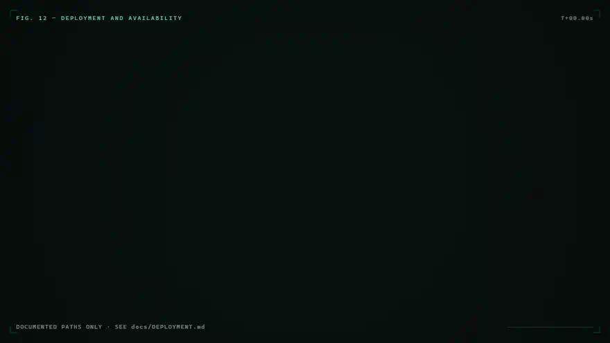
  </picture>
</p>

| Where | How | Notes |
| :-- | :-- | :-- |
| **Local** | `npm install` → `npm start` | <http://localhost:4173>, JSON store for development |
| **Railway** | `railway.json` + `Procfile` (`web: node src/server.js`) | NIXPACKS build, health check `/api/health`, `numReplicas: 1`, attach PostgreSQL via `DATABASE_URL` |
| **Any Node ≥ 20 host** | `node src/server.js` | Provide PostgreSQL and the production environment; see [`docs/DEPLOYMENT.md`](docs/DEPLOYMENT.md) and [`docs/LAUNCH_CHECKLIST.md`](docs/LAUNCH_CHECKLIST.md) |

<br>

## 15 — Release Evolution

Formspear has **no tagged releases yet**, so there is no release timeline to draw and none is fabricated. The development history is the lattice above: the first commit landed on 2026-06-28 and every commit since is a cube. When the first release is published, the lattice gains its first layer automatically.

<br>

## 16 — Documentation and Community

| Read | |
| :-- | :-- |
| [`docs/ARCHITECTURE.md`](docs/ARCHITECTURE.md) | Runtime boundaries, persistence, verification boundary |
| [`docs/API.md`](docs/API.md) | HTTP and API reference |
| [`docs/DEPLOYMENT.md`](docs/DEPLOYMENT.md) | Deployment runbook, PostgreSQL, Redis, storage |
| [`docs/SECURITY_AND_PRIVACY.md`](docs/SECURITY_AND_PRIVACY.md) | Security and privacy notes |
| [`docs/OPERATIONS_RUNBOOK.md`](docs/OPERATIONS_RUNBOOK.md) | Operating the service |
| [`docs/readme-art/`](docs/readme-art/ANIMATION_INVENTORY.md) | Creative direction, storyboards, review log, known limitations of the artwork |

Verification gates: `npm run check`, `npm run migrations:check`, `npm test` (59 test cases across 31 files), `npm run performance:smoke`, `npm run performance:budget`, `npm run backup:smoke`, `npm run visual:smoke`. Issues and discussion happen on the [GitHub repository](https://github.com/DecoyINDIA/Formspear/issues).

<br>

## 17 — The Perfect Structure

<p align="center">
  <picture>
    <source media="(prefers-reduced-motion: reduce)" srcset="assets/readme/art/static/perfect-structure.webp">
    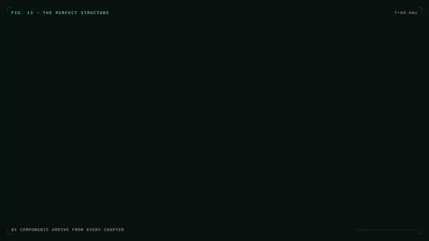
  </picture>
</p>

<p align="center"><sub>Formspear · MIT License · The artwork in this README is generated from <a href="tools/readme-art">tools/readme-art</a> and is reproducible with <code>node render.mjs</code>.</sub></p>
