# Storyboards

Contact sheets (6 frames per scene, read left→right, top→bottom). Beats and timings are in [MOTION_TIMING.md](MOTION_TIMING.md). Regenerate with `node tools/readme-art/render.mjs --sheet 6`.

| Fig | Scene | Sheet |
| :-- | :-- | :-- |
| 01 | The Emergence of Order | 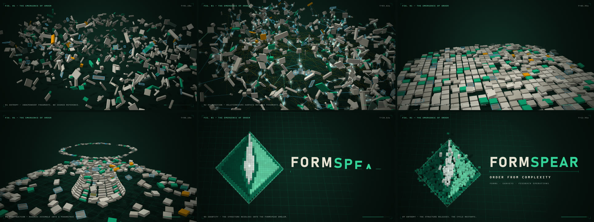 |
| 04 | The Form Architect | 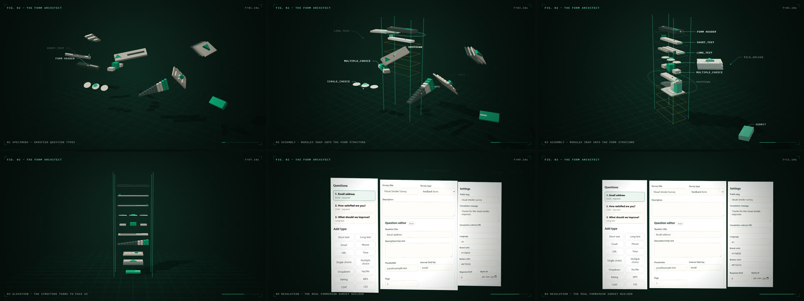 |
| 05 | Components of Possibility | 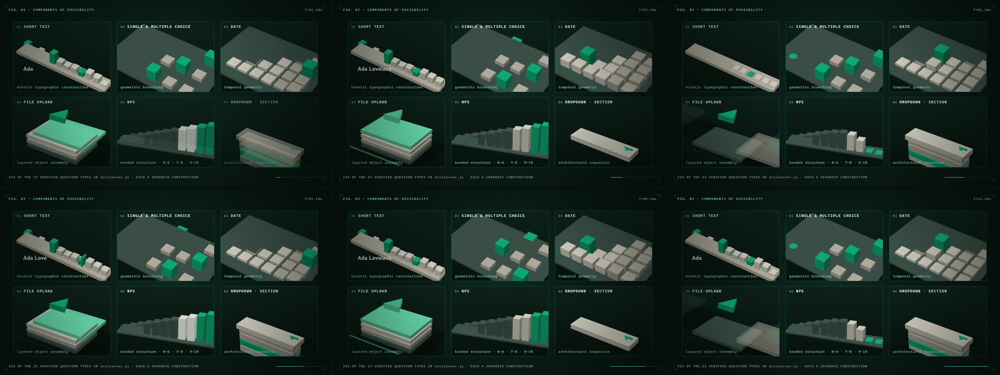 |
| 06 | The Logic Machine | 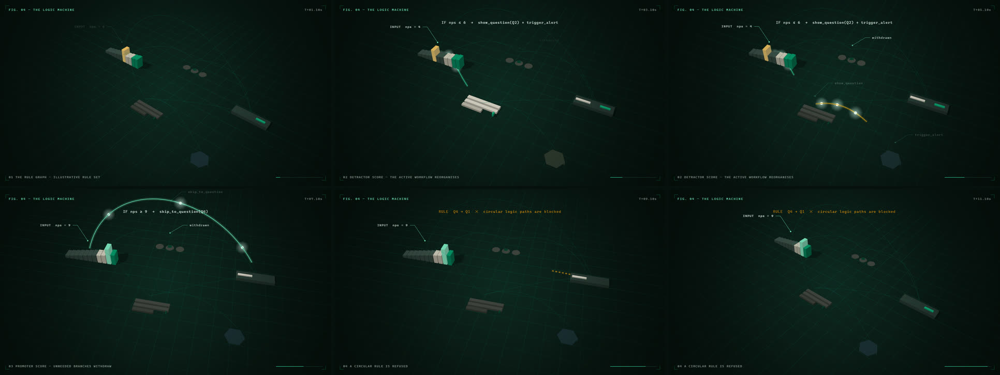 |
| 07 | Information Becomes Structure | 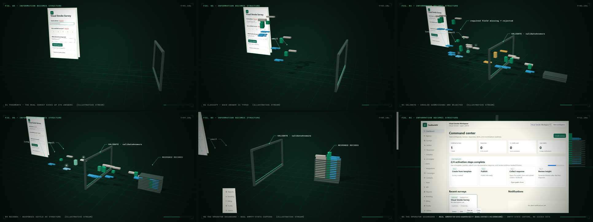 |
| 08 | Precision by Design | 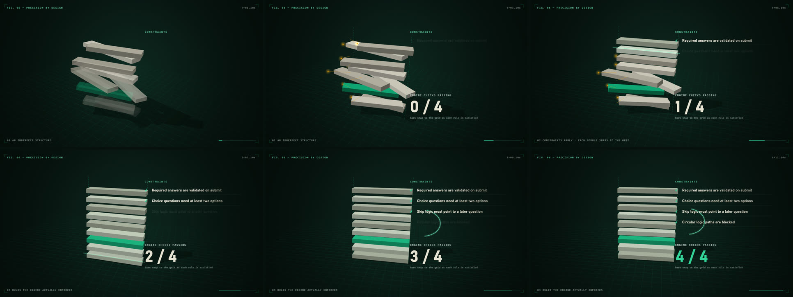 |
| 09 | The Workflow Continuum | 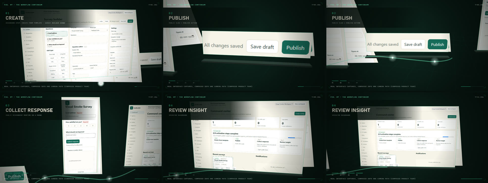 |
| 10 | Engineering Beneath the Surface | 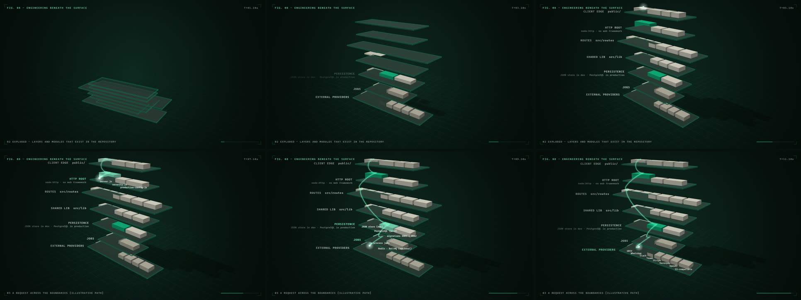 |
| 11 | Connected by Design | 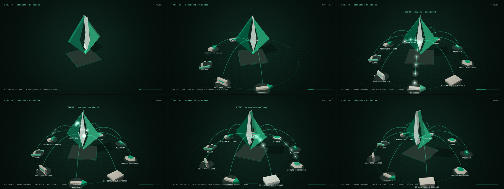 |
| 12 | Open by Design | 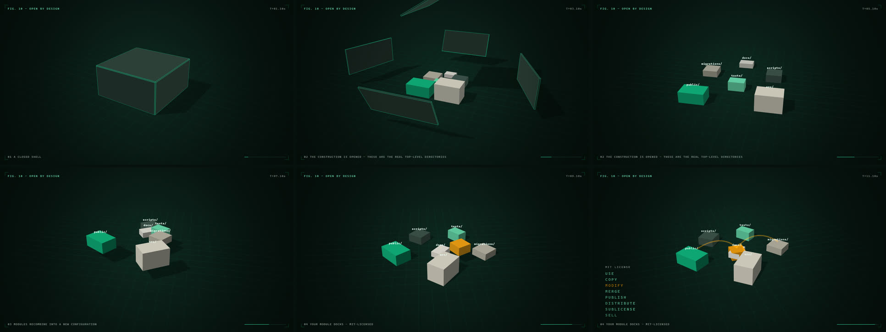 |
| 14 | Deployment and Availability | 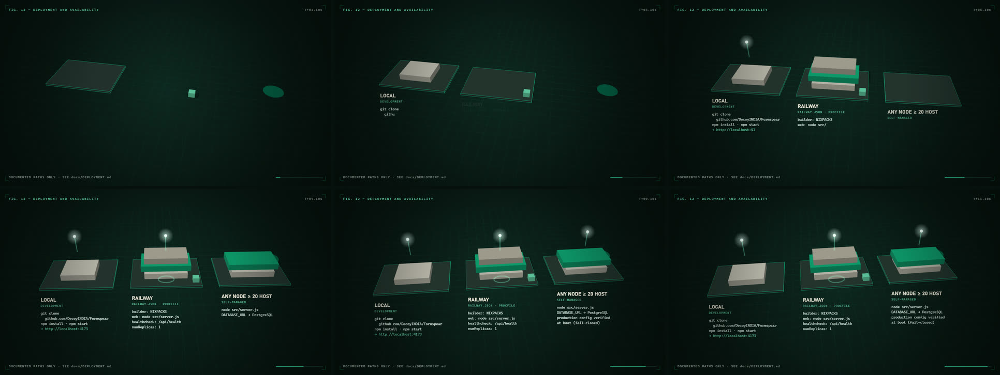 |
| 17 | The Perfect Structure | 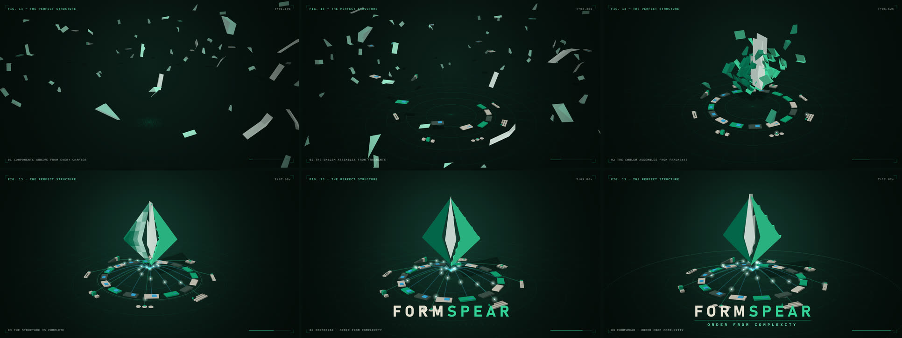 |
